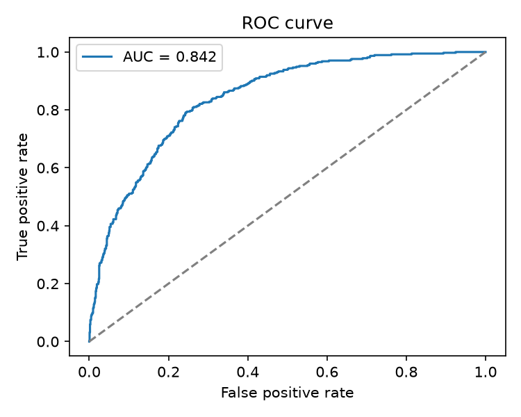
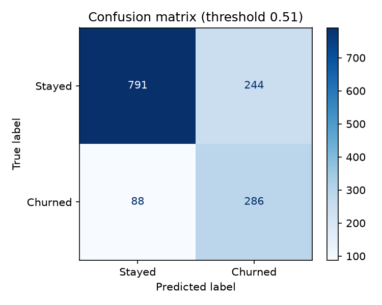
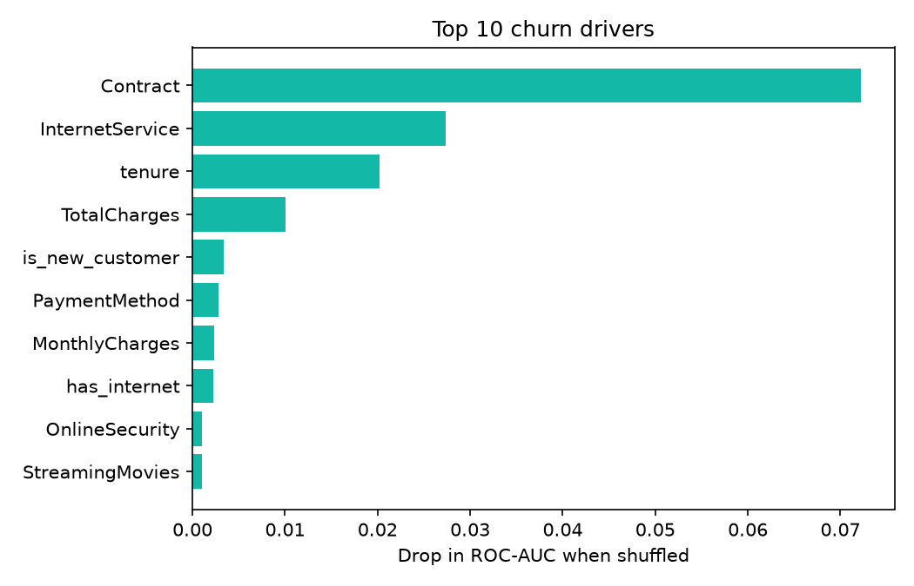

# Customer Churn Prediction

Predicts which telecom customers are likely to cancel, using the Telco Customer Churn dataset (7,043 customers, 21 columns), and serves predictions through a FastAPI service.

## Results

Three models were compared with 5-fold cross-validation, then scored on a held-out 20% test set.

| Model | CV AUC | Test AUC | Recall | Precision |
|---|---|---|---|---|
| Logistic regression | <fill> | <fill> | <fill> | <fill> |
| Random forest | <fill> | <fill> | <fill> | <fill> |
| Gradient boosting | <fill> | <fill> | <fill> | <fill> |

Best model: **<name>**, test AUC **<fill>**. The decision threshold (<fill>) was chosen on cross-validated training predictions only, so the test set was never used to tune it.

At that threshold the model caught <fill> of <fill> real churners in the test set.





## Key findings

- Month-to-month customers churn at <fill>%, versus <fill>% on two-year contracts.
- Customers in their first 12 months churn at <fill>%, versus <fill>% for the rest.
- Electronic-check payers churn most (<fill>%).
- The top drivers by permutation importance are <fill>, <fill> and <fill>.

## Method

- Cleaning: converted `TotalCharges` to numeric (11 blank rows belong to new customers with tenure 0), dropped `customerID`, merged "No internet service" and "No phone service" into "No".
- Features added: `num_addons`, `is_new_customer`, `has_internet`.
- Class imbalance (26.5% churn) handled with balanced class weights, and models judged by AUC, recall and precision, because plain accuracy is misleading here.
- Scaling and one-hot encoding live inside a scikit-learn pipeline, so the API applies exactly the same steps as training.

## Run it

```bash
python -m venv venv
venv\Scripts\activate
pip install -r requirements.txt
```

Download `WA_Fn-UseC_-Telco-Customer-Churn.csv` from [Kaggle](https://www.kaggle.com/datasets/blastchar/telco-customer-churn) into `data/raw/`, then:

```bash
python src/preprocess.py
python src/train.py
python src/evaluate.py
uvicorn api.main:app --port 8001
```

Open http://127.0.0.1:8001/docs and try `POST /predict`.

```bash
python -m pytest -q
```

## Project structure

```
src/        preprocess.py, train.py, evaluate.py
api/        FastAPI service (schemas, feature rebuild, /predict)
models/     trained pipeline, threshold, model comparison
reports/    charts
tests/      API tests
```

## Limitations

The dataset is a single snapshot of a fictional telecom, so the model shows the workflow rather than real-world performance. A production version would need time-based validation and retraining.